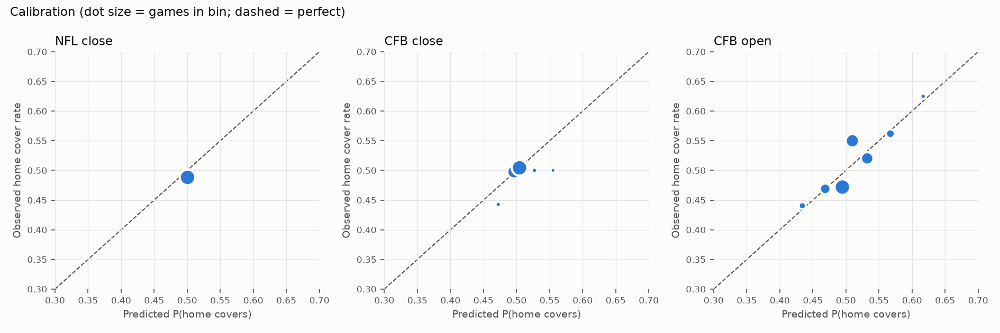

# Walk-forward backtest

Generated 2026-11-06 06:26 UTC. Regenerate with `python -m ats backtest`.

Every prediction uses only games that kicked off before that week's Tuesday 00:00 PT cutoff. Ratings, model fits, sigma, the NFL empirical margin distribution and calibration are all refit each week on past data only. Hyperparameters (prior strength, decay, ridge alpha) were fixed before running and not tuned on these results.

Break-even at -110 is 52.4%. A hit rate whose CI includes 50% is not distinguishable from a coin flip.

## NFL vs closing line

Evaluated seasons 2015-2026 (2026 partial); 3150 games with a line and a final score.

**Margin MAE (points, lower is better)**

| Market line | Ratings only (m2) | Blend (m3) |
|---|---|---|
| 9.80 | 10.21 | 9.82 |

Blend weights (first -> last week): market 0.91 -> 1.06, ratings model 0.15 -> -0.03. sigma (blend residual SD) averaged 13.0 pts.

**Brier score** (coin flip = 0.2500): calibrated blend 0.2500; ratings-only 0.2597.

**ATS hit rate of top-N picks per week** (pushes excluded)

| Picks | Record |
|---|---|
| Top 5 | 549-547 (50.1%, 95% CI 47.1-53.0, p=0.98) |
| Top 6 | 640-656 (49.4%, 95% CI 46.7-52.1, p=0.68) |
| Top 10 | 1009-1062 (48.7%, 95% CI 46.6-50.9, p=0.25) |
| All games | 1500-1569 (48.9%, 95% CI 47.1-50.6, p=0.22) |

Model weight w (share of the model's disagreement with the market that is used): first 0.00, last 0.00, mean 0.00.

**Hit rate by calibrated edge** (all games)

| Edge | n | Hit rate | 95% CI |
|---|---|---|---|
| (-0.001, 0.01] | 3069 | 48.9% | 47.1-50.6 |

**Calibration of P(home covers)**

| Bin | n | Mean predicted | Observed |
|---|---|---|---|
| (0.48, 0.5] | 3069.0 | 0.500 | 0.489 |

## CFB (FBS v FBS) vs closing line

Evaluated seasons 2016-2026 (2026 partial); 8067 games with a line and a final score.

**Margin MAE (points, lower is better)**

| Market line | Ratings only (m2) | Blend (m3) |
|---|---|---|
| 12.28 | 12.69 | 12.30 |

Blend weights (first -> last week): market 0.84 -> 0.93, ratings model 0.26 -> 0.08. sigma (blend residual SD) averaged 16.0 pts.

**Brier score** (coin flip = 0.2500): calibrated blend 0.2500; ratings-only 0.2587.

**ATS hit rate of top-N picks per week** (pushes excluded)

| Picks | Record |
|---|---|
| Top 5 | 474-486 (49.4%, 95% CI 46.2-52.5, p=0.72) |
| Top 6 | 567-575 (49.6%, 95% CI 46.8-52.5, p=0.84) |
| Top 10 | 910-920 (49.7%, 95% CI 47.4-52.0, p=0.83) |
| All games | 3988-3921 (50.4%, 95% CI 49.3-51.5, p=0.46) |

Model weight w (share of the model's disagreement with the market that is used): first 0.00, last 0.28, mean 0.30.

**Hit rate by calibrated edge** (all games)

| Edge | n | Hit rate | 95% CI |
|---|---|---|---|
| (-0.001, 0.01] | 6970 | 50.4% | 49.3-51.6 |
| (0.01, 0.02] | 710 | 49.6% | 45.9-53.2 |
| (0.02, 0.03] | 164 | 53.0% | 45.4-60.5 |
| (0.03, 0.05] | 58 | 53.4% | 40.8-65.7 |
| (0.05, 1.0] | 7 | 42.9% | 15.8-75.0 |

**Calibration of P(home covers)**

| Bin | n | Mean predicted | Observed |
|---|---|---|---|
| (0.4, 0.45] | 1.0 | 0.450 | 1.000 |
| (0.45, 0.48] | 122.0 | 0.472 | 0.443 |
| (0.48, 0.5] | 3179.0 | 0.496 | 0.498 |
| (0.5, 0.52] | 4501.0 | 0.504 | 0.504 |
| (0.52, 0.55] | 100.0 | 0.527 | 0.500 |
| (0.55, 0.6] | 6.0 | 0.555 | 0.500 |

## CFB (FBS v FBS) vs opening line

Evaluated seasons 2023-2026 (2026 partial); 2502 games with a line and a final score.

**Margin MAE (points, lower is better)**

| Market line | Ratings only (m2) | Blend (m3) |
|---|---|---|
| 12.23 | 12.34 | 12.18 |

Blend weights (first -> last week): market 0.97 -> 0.70, ratings model 0.05 -> 0.32. sigma (blend residual SD) averaged 15.6 pts.

**Brier score** (coin flip = 0.2500): calibrated blend 0.2487; ratings-only 0.2526.

**ATS hit rate of top-N picks per week** (pushes excluded)

| Picks | Record |
|---|---|
| Top 5 | 156-123 (55.9%, 95% CI 50.0-61.6, p=0.06) |
| Top 6 | 184-145 (55.9%, 95% CI 50.5-61.2, p=0.04) |
| Top 10 | 281-241 (53.8%, 95% CI 49.5-58.1, p=0.09) |
| All games | 1309-1158 (53.1%, 95% CI 51.1-55.0, p=0.00) |

Model weight w (share of the model's disagreement with the market that is used): first 0.00, last 0.86, mean 0.79.

**Closing-line value of picks made at the open** (points the line moved toward our side)

| Picks | n | Mean move | % toward us | % away |
|---|---|---|---|---|
| Top 5 | 302 | +2.65 | 59% | 17% |
| Top 10 | 566 | +1.94 | 55% | 19% |
| All | 2592 | +0.76 | 47% | 28% |

Robustness: excluding games whose line moved >7 pts open->close (likely stale or erroneous openers), top 5 = 145-134 (52.0%, 95% CI 46.1-57.8, p=0.55).

**Hit rate by calibrated edge** (all games)

| Edge | n | Hit rate | 95% CI |
|---|---|---|---|
| (-0.001, 0.01] | 876 | 51.4% | 48.1-54.7 |
| (0.01, 0.02] | 457 | 54.3% | 49.7-58.8 |
| (0.02, 0.03] | 395 | 51.1% | 46.2-56.0 |
| (0.03, 0.05] | 398 | 53.8% | 48.9-58.6 |
| (0.05, 1.0] | 341 | 57.2% | 51.9-62.3 |

**Calibration of P(home covers)**

| Bin | n | Mean predicted | Observed |
|---|---|---|---|
| (-0.001, 0.4] | 14.0 | 0.373 | 0.286 |
| (0.4, 0.45] | 109.0 | 0.434 | 0.440 |
| (0.45, 0.48] | 322.0 | 0.469 | 0.469 |
| (0.48, 0.5] | 782.0 | 0.495 | 0.472 |
| (0.5, 0.52] | 551.0 | 0.510 | 0.550 |
| (0.52, 0.55] | 471.0 | 0.532 | 0.520 |
| (0.55, 0.6] | 194.0 | 0.567 | 0.562 |
| (0.6, 1.0] | 24.0 | 0.617 | 0.625 |

## CFB stale line: model sees the close, graded against the opener

Stand-in for the pickem sheet: a fixed line set early in the week, while the model sees a later market line. This is optimistic, because the close is the latest possible line and the live line at Friday's deadline has moved less. Only seasons with openers (2023+) are graded.

Evaluated seasons 2021-2026 (2026 partial); 2702 games with a line and a final score.

**Margin MAE (points, lower is better)**

| Market line | Ratings only (m2) | Blend (m3) |
|---|---|---|
| 11.90 | 12.30 | 11.92 |

Blend weights (first -> last week): market 0.85 -> 0.93, ratings model 0.18 -> 0.08. sigma (blend residual SD) averaged 15.1 pts.

**Brier score** (coin flip = 0.2500): calibrated blend 0.2446; ratings-only 0.2603.

**ATS hit rate of top-N picks per week** (pushes excluded)

| Picks | Record |
|---|---|
| Top 5 | 188-121 (60.8%, 95% CI 55.3-66.1, p=0.00) |
| Top 6 | 225-140 (61.6%, 95% CI 56.6-66.5, p=0.00) |
| Top 10 | 345-232 (59.8%, 95% CI 55.7-63.7, p=0.00) |
| All games | 1467-1197 (55.1%, 95% CI 53.2-56.9, p=0.00) |

Model weight w (share of the model's disagreement with the market that is used): first 0.00, last 0.30, mean 0.47.

**Hit rate by calibrated edge** (all games)

| Edge | n | Hit rate | 95% CI |
|---|---|---|---|
| (-0.001, 0.01] | 649 | 51.9% | 48.1-55.7 |
| (0.01, 0.02] | 409 | 50.1% | 45.3-54.9 |
| (0.02, 0.03] | 298 | 49.7% | 44.0-55.3 |
| (0.03, 0.05] | 402 | 54.5% | 49.6-59.3 |
| (0.05, 1.0] | 906 | 61.6% | 58.4-64.7 |

**Calibration of P(home covers)**

| Bin | n | Mean predicted | Observed |
|---|---|---|---|
| (-0.001, 0.4] | 163.0 | 0.348 | 0.344 |
| (0.4, 0.45] | 292.0 | 0.430 | 0.408 |
| (0.45, 0.48] | 336.0 | 0.467 | 0.473 |
| (0.48, 0.5] | 563.0 | 0.493 | 0.492 |
| (0.5, 0.52] | 495.0 | 0.508 | 0.527 |
| (0.52, 0.55] | 364.0 | 0.533 | 0.522 |
| (0.55, 0.6] | 304.0 | 0.570 | 0.632 |
| (0.6, 1.0] | 147.0 | 0.645 | 0.585 |

## NFL stale line: model sees the close, graded against the opener

Same design for NFL. Openers come from the aussportsbetting.com spreadsheet (data/raw/manual/nfl.xlsx, downloaded by hand; 2012+ here). Their opener is posted around Sunday night, earlier than the pool sheet, so this is optimistic too.

Evaluated seasons 2015-2026 (2026 partial); 3121 games with a line and a final score.

**Margin MAE (points, lower is better)**

| Market line | Ratings only (m2) | Blend (m3) |
|---|---|---|
| 9.79 | 10.20 | 9.80 |

Blend weights (first -> last week): market 0.91 -> 1.06, ratings model 0.15 -> -0.03. sigma (blend residual SD) averaged 13.0 pts.

**Brier score** (coin flip = 0.2500): calibrated blend 0.2448; ratings-only 0.2649.

**ATS hit rate of top-N picks per week** (pushes excluded)

| Picks | Record |
|---|---|
| Top 5 | 663-433 (60.5%, 95% CI 57.6-63.3, p=0.00) |
| Top 6 | 768-528 (59.3%, 95% CI 56.6-61.9, p=0.00) |
| Top 10 | 1177-896 (56.8%, 95% CI 54.6-58.9, p=0.00) |
| All games | 1691-1370 (55.2%, 95% CI 53.5-57.0, p=0.00) |

Model weight w (share of the model's disagreement with the market that is used): first 0.00, last 0.00, mean 0.00.

**Hit rate by calibrated edge** (all games)

| Edge | n | Hit rate | 95% CI |
|---|---|---|---|
| (-0.001, 0.01] | 615 | 51.7% | 47.8-55.6 |
| (0.01, 0.02] | 286 | 51.7% | 46.0-57.5 |
| (0.02, 0.03] | 338 | 47.9% | 42.7-53.2 |
| (0.03, 0.05] | 673 | 54.5% | 50.8-58.3 |
| (0.05, 1.0] | 1149 | 60.6% | 57.7-63.4 |

**Calibration of P(home covers)**

| Bin | n | Mean predicted | Observed |
|---|---|---|---|
| (-0.001, 0.4] | 209.0 | 0.348 | 0.354 |
| (0.4, 0.45] | 380.0 | 0.426 | 0.379 |
| (0.45, 0.48] | 496.0 | 0.464 | 0.482 |
| (0.48, 0.5] | 733.0 | 0.496 | 0.501 |
| (0.5, 0.52] | 171.0 | 0.513 | 0.544 |
| (0.52, 0.55] | 515.0 | 0.535 | 0.526 |
| (0.55, 0.6] | 366.0 | 0.572 | 0.557 |
| (0.6, 1.0] | 191.0 | 0.657 | 0.623 |

## Combined NFL + CFB ranking vs closing line (2016+)

| Picks | Record |
|---|---|
| Top 5 | 549-560 (49.5%, 95% CI 46.6-52.4, p=0.76); 87% CFB |
| Top 10 | 1037-1042 (49.9%, 95% CI 47.7-52.0, p=0.93); 88% CFB |

## Placebo check (market right by construction)

Same pipeline on synthetic outcomes: margin = -line + a residual shuffled across games within each season, and efficiency stats shuffled too. The line is unbiased and outcomes carry no game-specific signal, so anything far from 50% here would mean the pipeline manufactures edge.

| Run | Top 5 | Top 10 |
|---|---|---|
| NFL close (placebo) | 538-558 (49.1%, 95% CI 46.1-52.0, p=0.57) | 1008-1066 (48.6%, 95% CI 46.5-50.8, p=0.21) |
| CFB open (placebo) | 140-141 (49.8%, 95% CI 44.0-55.6, p=1.00) | 265-261 (50.4%, 95% CI 46.1-54.6, p=0.90) |

